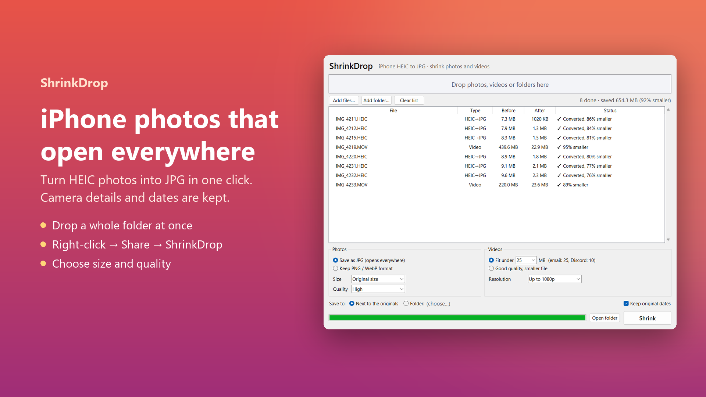

# ShrinkDrop

Convert iPhone **HEIC photos to JPG** and **shrink photos and videos** on Windows 10 and 11. Everything happens on your PC; nothing is uploaded.



- **HEIC → JPG** in one click, keeping camera details (EXIF), colour profile and file dates
- **Shrink videos to a size you choose**, like 25 MB for email or 10 MB for Discord. Portrait iPhone videos stay the right way up.
- **Shrink photos** to 4K, 2048 or 1600 px at the quality you pick
- Drop files or whole folders, or right-click a file → **Share → ShrinkDrop** (Store version) / **Shrink with ShrinkDrop** (download version)
- Originals are never changed. `IMG_1234.HEIC` → `IMG_1234.jpg`, `IMG_1235.MOV` → `IMG_1235 (small).mp4`

## Get it

- **Microsoft Store:** search "ShrinkDrop" (7-day free trial)
- **Direct download:** https://tiger1247.github.io

## Run from source

```bash
python -m venv build\venv
build\venv\Scripts\pip install pillow pillow-heif av tkinterdnd2
build\venv\Scripts\python src\main.py
```

Packaging: `packaging\build_msix.py` (Microsoft Store) and `packaging\build_portable.py` (download zip).

## Licence

ShrinkDrop is free software under the [GNU GPL v3](LICENSE). It bundles FFmpeg, x264, libheif and other libraries; see [THIRD_PARTY_NOTICES.txt](THIRD_PARTY_NOTICES.txt). [Privacy policy](PRIVACY.md).
